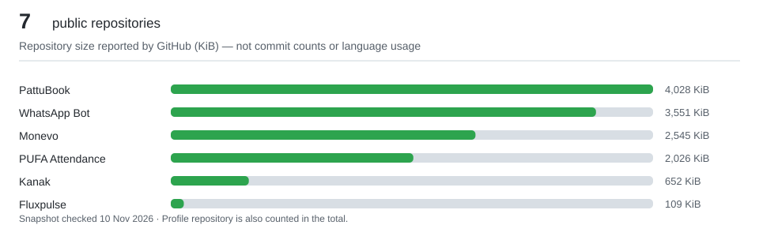

  

  <strong>Communication Design Student · Android Developer · Creative Technologist</strong>

I design and build software around real problems in my everyday life. My apps are personal tools first — and I enjoy making them as thoughtfully designed, reliable, and polished as professional products.

- 📱 **Development:** Kotlin, Jetpack Compose, Android Studio, local-first Android apps
- 🎨 **Design:** Interface design, visual systems, Photoshop and motion
- ⚙️ **Interests:** Technology, hardware, networking and optimization

---

### Featured projects

**[Kanak](https://github.com/sathwikcherott/kanak-app)** · My daily-driver personal finance app. Quick and voice expense entry, spending insights, category suggestions, and backup/restore.

**[PattuBook](https://github.com/sathwikcherott/pattubook)** · The personal lending ledger I open whenever I lend money. Track who owes what, log repayments, and keep records organized.

**Other repositories:** [Fluxpulse](https://github.com/sathwikcherott/Fluxpulse) · [Monevo](https://github.com/sathwikcherott/monevo) · [PUFA Attendance Manager](https://github.com/sathwikcherott/PUFA.Attendance.Manager)

### Tech & creative tools

`Kotlin` · `Jetpack Compose` · `Android Studio` · `Git` · `GitHub` · `Photoshop` · `UI/UX` · `Motion Design`

### GitHub, in numbers

  

> The chart shows repository storage sizes reported by GitHub, **not** programming-language shares, commit counts, or personal productivity. Snapshot: 10 November 2026. For current contributions, see my [GitHub activity](https://github.com/sathwikcherott?tab=overview).

---

Design it. Build it. Use it. Refine it.

